# Raport techniczny – Projekt 1

## Streszczenie
Na 3000 firmach (DR 13,7%) zbudowano dwa modele PD: interpretowalną kartę scoringową (regresja logistyczna na WoE, 9 cech) i model black-box (LightGBM z ograniczeniami monotonicznymi). Na teście LightGBM osiąga Gini 0,46  wobec 0,42 karty. Różnica +0,042 jest statystycznie nieistotna, a na walidacji krzyżowej karta była nieznacznie lepsza (AUC 0,718 vs 0,708). 
Oba modele opierają się na tych samych czynnikach: struktura kapitału, rentowność, rotacja, kapitał obrotowy i zadłużenie krótkoterminowe. 
**Jako model rekomendowany wybrano kartę scoringową**: przy statystycznie takiej samej skuteczności jest interpretowalna z konstrukcji i ma stabilniejsze wyjaśnienia. LightGBM pozostaje modelem porównawczym. 
PD skalibrowano metodą Platta i przesunięto do tendencji centralnej 4%. 

---

## 1. Walidacja i podziały – notebook 01
- **Podział**: stratyfikowany, seed 42 – train 70% (2099 firm, 288 defaultów), valid 15% (451, 62), test 15% (450, 62); 5-fold stratyfikowana CV na train. DR w każdym zbiorze i foldzie 13,6–13,8%. Indeksy podziału zzostały zapisane w `splits/splits.json`.

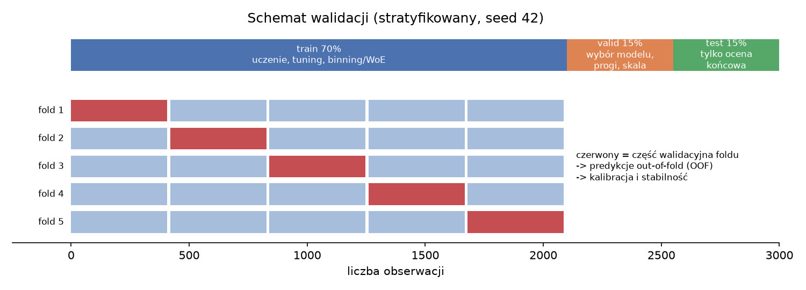

| Operacja | Dopasowanie | Zastosowanie |
|---|---|---|
| capping, binning / WoE, grupowanie rzadkich kategorii | foldy treningowe / train | fold walidacyjny, valid, test |
| selekcja cech, tuning | CV na train | – |
| kalibracja kształtu, przesunięcie δ | valid (wybór metody: CV wewnątrz valid) | test |
| wybór modelu, próg | valid i CV | test |
| ocena końcowa | – | test (jednorazowo) |

**Kontrola przecieku**: AUC pojedynczych cech na train. Żadna cecha nie przekracza progu alarmowego AUC > 0,85. 
Najsilniejsze pojedynczo są `wsk_index_skr_zaw` i `wsk_index_nowe` (AUC 0,69–0,71). 
Te kolumny, razem z `wsk_index_aktywne`, nie mają opisu w słowniku danych, więc wykluczono je, bo nie można potwierdzić, że były znane w dniu decyzji. Po wykluczeniu żadna cecha nie ma IV > 0,5.

## 2. Przygotowanie danych i EDA – notebook 02
- **Data Quality**: 
	- kolumny rachunku przepływów puste w 95–99%; 
	- ±inf w 3 wskaźnikach (dzielenie przez 0; `wsk_plynnosc_biez_1` – 31% wartości); 
	- 210 z 220 kolumn o skośności |s| > 2; 
	- 38 firm z aktywami ≤ 0, 361 z zerowymi przychodami. 
	- Usunięto 2 kolumny stałe.
- **Polityka cech**: 
	- wskaźniki finansowe + log(aktywa), log(przychody) + kategorie (forma własności, sekcja PKD, schemat sprawozdania); 
	- ±inf → brak; 
	- capping – do percentyli 1–99% (granice z train; mediana |skośności| 36,2 → 5,0);
	- odrzucone kolumny z > 50% braków i duplikaty (138 → 125 cech liczbowych).
- **EDA**: 
	- najsilniejsze cechy (IV ≈ 0,4) to struktura kapitału i zadłużenie; 
	- 164 pary cech z |ρ| > 0,9 (ten sam wskaźnik w kilku wersjach); 
	- branża – najwyższe DR w gastronomii (30%) i energetyce (21%).
- **Zależność niemonotoniczna (kształt U)**: 

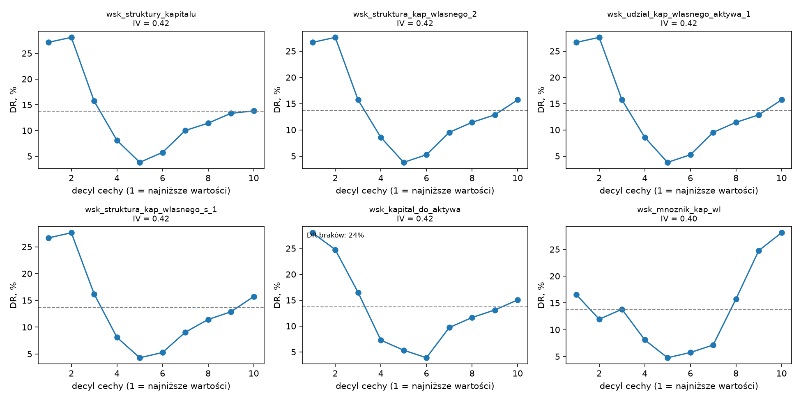

- DR w decylach 6 cech o najwyższym IV jest najniższy w środku rozkładu i rośnie na obu końcach. Wszystkie to wskaźniki struktury kapitału.
  Uzasadnienie ekonomiczne: niski lub ujemny kapitał własny oznacza finansowanie długiem, a bardzo wysoki kapitał przy znikomych zobowiązaniach to często firma bez realnej działalności. Dlatego 8 wskaźników z tej grupy (6 z wykresu i 2 inne wersje tego samego wskaźnika) dostaje wyjątek `U_SHAPE`: w karcie przedziały bez wymogu monotoniczności, w LightGBM bez ograniczenia monotonicznego. 

## 3. Model interpretowalny – notebook 03
- **Algorytm**: karta scoringowa – binning (start od 10 kwantyli, max 5 przedziałów, ≥ 5% firm w przedziale, monotoniczna stopa złych, wyjątek `U_SHAPE`; braki jako osobny przedział) → WoE → regresja logistyczna.
- **Selekcja**: 119 ze 129 kandydatów ma IV ≥ 0,02; pula 31 cech po redukcji korelacji (|ρ| WoE ≤ 0,6); selekcja krokowa w przód na 5-fold CV, z binningiem uczonym w każdym foldzie i kontrolą znaków β. Maksimum AUC CV w zakresie 8–12 cech przypada na 9 cech (0,718); dalsze cechy nie poprawiają wyniku.
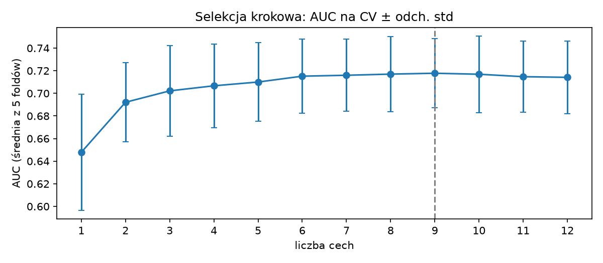

- **Cechy i współczynniki**:
  Wszystkie β < 0 , VIF ≤ 1,91 – brak współliniowości.

| Cecha                                  |      β |  VIF |    IV | Liczba przedziałów | Znak OK (β < 0) |
| -------------------------------------- | -----: | ---: | ----: | -----------------: | :-------------: |
| `wsk_struktury_kapitalu`               | −0,503 | 1,91 | 0,411 |                  5 |        ✓        |
| `wsk_zysk_zobowiazania`                | −0,400 | 1,61 | 0,307 |                  5 |        ✓        |
| `wsk_rotacja_wartosci_niewaterialnych` | −0,601 | 1,71 | 0,194 |                  5 |        ✓        |
| `wsk_zadluzenia_krotkie`               | −0,675 | 1,79 | 0,194 |                  3 |        ✓        |
| `wsk_poziom_kapitalu_obrotowego_netto` | −0,355 | 1,50 | 0,236 |                  5 |        ✓        |
| `wsk_struktury_finansowania`           | −0,795 | 1,33 | 0,081 |                  3 |        ✓        |
| `schemat_wsk_rzis`                     | −0,878 | 1,03 | 0,023 |                  3 |        ✓        |
| `wsk_zast_kapitalu_podstawowego`       | −0,647 | 1,10 | 0,034 |                  4 |        ✓        |
| `wsk_stopa_zysku_sprzedaz`             | −0,391 | 1,65 | 0,302 |                  5 |        ✓        |

- **Jakość**: AUC CV 0,718 ± 0,034 (Gini 0,44 ± 0,07), train 0,749, OOF 0,716, valid 0,748, test 0,708.
- **Interpretacja globalna**: 

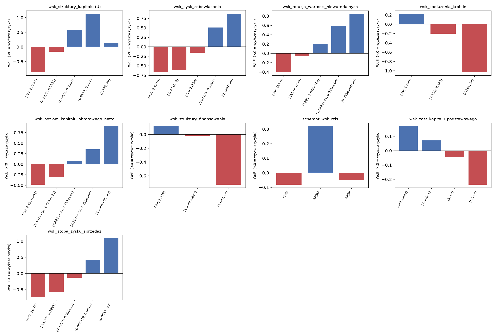

 Profile WoE - wyższy zysk względem zobowiązań, wyższa rentowność sprzedaży, wyższa rotacja i większy kapitał obrotowy → niższe ryzyko; wyższe zadłużenie krótkoterminow i wyższa struktura finansowania → wyższe ryzyko. Struktura kapitału ma kształt U: DR 28% w najniższym przedziale, 4,8% w przedziale [1,0; 2,9] i 12,1% powyżej 2,9. Zależności są zgodne z intuicją ekonomiczną.
- **Karta punktowa**

| Cecha | Przedział | WoE | Punkty |
|---|---|---:|---:|
| `wsk_struktury_kapitalu` (U) | < 0,303 | −0,871 | 47 |
| | [0,303; 0,593) | −0,164 | 58 |
| | [0,593; 0,999) | 0,572 | 68 |
| | [0,999; 2,922) | 1,138 | **77** |
| | ≥ 2,922 | 0,143 | 62 |
| `wsk_zysk_zobowiazania` | < −0,432 | −0,675 | 52 |
| | [−0,432; 0) | −0,610 | 53 |
| | [0; 0,041) | −0,154 | 58 |
| | [0,041; 0,166) | 0,511 | 66 |
| | ≥ 0,166 | 0,875 | 70 |
| `wsk_rotacja_wartosci_niewaterialnych` | < 490 | −0,410 | 53 |
| | [490; 1 696) | −0,059 | 59 |
| | [1 696; 10 480) | 0,207 | 64 |
| | [10 480; 60 350) | 0,585 | 70 |
| | ≥ 60 350 | 0,852 | 75 |
| `wsk_zadluzenia_krotkie` | < 1,199 | 0,228 | 65 |
| | [1,199; 3,165) | −0,202 | 56 |
| | ≥ 3,165 | −1,036 | 40 |
| `wsk_poziom_kapitalu_obrotowego_netto` | < 24 570 | −0,487 | 55 |
| | [24 570; 66 640) | −0,300 | 57 |
| | [66 640; 275 700) | 0,072 | 61 |
| | [275 700; 1 039 000) | 0,355 | 64 |
| | ≥ 1 039 000 | 0,910 | 69 |
| `wsk_struktury_finansowania` | < 1,339 | 0,125 | 63 |
| | [1,339; 1,607) | −0,017 | 60 |
| | ≥ 1,607 | −0,729 | 43 |
| `schemat_wsk_rzis` | SFJIN (pozostałe jednostki) | −0,082 | 58 |
| | SFJMA (mała jednostka) | 0,322 | 68 |
| | SFJMI (mikrojednostka) | −0,050 | 59 |
| `wsk_zast_kapitalu_podstawowego` | < 1,449 | 0,173 | 63 |
| | [1,449; 5) | 0,071 | 61 |
| | [5; 50) | −0,044 | 59 |
| | ≥ 50 | −0,237 | 56 |
| `wsk_stopa_zysku_sprzedaz` | < −16,75 | −0,726 | 52 |
| | [−16,75; −0,598) | −0,568 | 54 |
| | [−0,598; 0,006) | −0,129 | 59 |
| | [0,006; 0,082) | 0,409 | 65 |
| | ≥ 0,082 | 1,091 | 72 |

## 4. Model black-box – notebook 04
- **Algorytm**: LightGBM na tej samej puli 31 cech. Random search (60 konfiguracji) na 5-fold CV w przestrzeni modeli płytkich i silnie regularyzowanych; wybór: najwyższe AUC CV przy luce train–CV < 0,10 (29 z 60 konfiguracji).
  Wynik: 482 drzewa głębokości 1, learning rate 0,022 – model addytywny.
- **Ograniczenia monotoniczne** dla 27 cech (bez ograniczeń kategorie i cechy `U_SHAPE`): AUC CV 0,708 vs 0,705 bez ograniczeń, więc wariant monotoniczny wybrano do dalszej analizy.
- **Jakość**: AUC CV 0,708 ± 0,040, train 0,769, valid 0,758, test 0,730; złożoność: 482 drzewa, 964 liście, 29 z 31 cech użytych.

## 5. Wyjaśnialność – notebook 05
**Globalnie** (SHAP na teście, log-szanse; `05_waznosc_shap.png`, `05_beeswarm.png`, `05_zaleznosci_shap.png`):

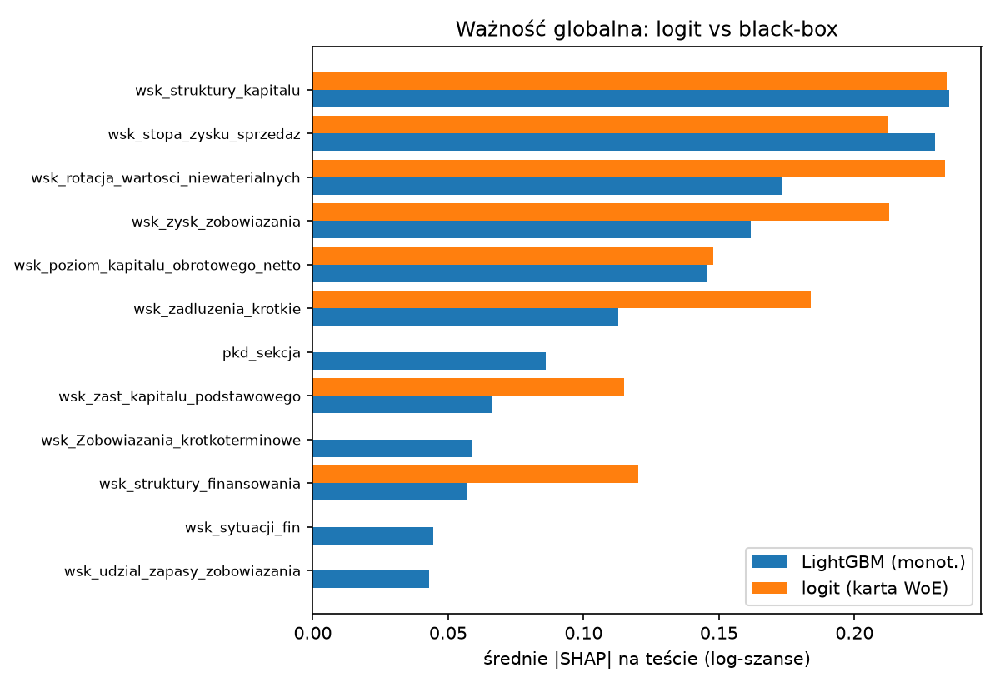

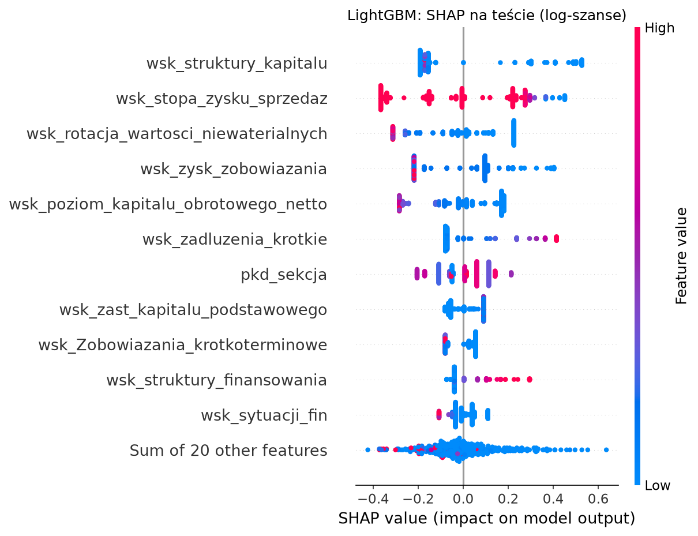

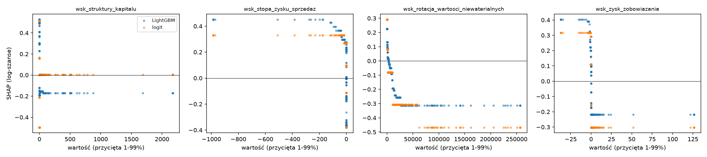

| Cecha                              | śr. \|SHAP\| karta | śr. \|SHAP\| LightGBM | Interpretacja                                                                                                      |
| ---------------------------------- | ------------------ | --------------------- | ------------------------------------------------------------------------------------------------------------------ |
| struktura kapitału                 | 0,23               | 0,24                  | mały kapitał własny = finansowanie długiem; bardzo duży przy znikomych zobowiązaniach – firmy bez działalności (U) |
| stopa zysku ze sprzedaży           | 0,21               | 0,23                  | firma ze stratą na sprzedaży nie generuje środków na obsługę długu                                                 |
| rotacja wartości niematerialnych   | 0,23               | 0,17                  | niska sprzedaż względem majątku niematerialnego – słaba efektywność                                                |
| zysk / zobowiązania                | 0,21               | 0,16                  | zdolność obsługi zadłużenia z zysku                                                                                |
| kapitał obrotowy netto             | 0,15               | 0,15                  | bufor płynności; mały lub ujemny – ryzyko utraty płynności                                                         |
| zadłużenie krótkoterminowe         | 0,18               | 0,11                  | presja na płynność w horyzoncie roku                                                                               |
| struktura finansowania             | 0,12               | 0,06                  | wysoki udział finansowania zewnętrznego                                                                            |
| zastosowanie kapitału podstawowego | 0,11               | 0,07                  | relacja kapitału podstawowego do skali działalności                                                                |
| sekcja PKD                         | –                  | 0,09                  | ryzyko branżowe (gastronomia, energetyka, budownictwo)                                                             |

- **Zgodność modeli**: Spearman rankingów 0,75, 4 z 5 najważniejszych cech wspólne (Jaccard top-5 0,67). LightGBM rozkłada część wkładu na cechy, których karta nie ma (PKD, zobowiązania krótkoterminowe, sytuacja finansowa), bo korzysta z całej puli.
- **Kształt zależności** 

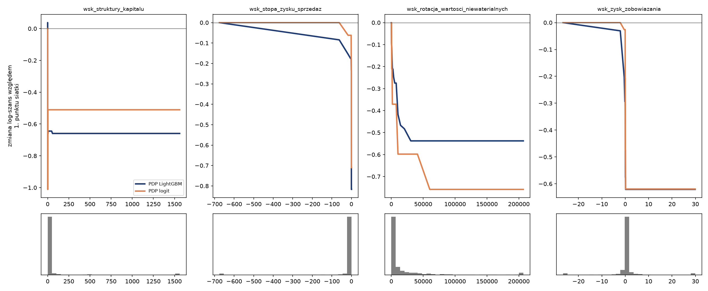

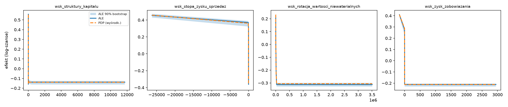

- progi przy przejściu ze strat do zysku, kształt U dla struktury kapitału w obu modelach. Krzywe c-ICE są równoległe (model addytywny), PDP i ALE zgodne (różnica 0,02–0,05 log-szans, 3–7% zakresu efektu), więc korelacje cech nie zniekształcają mocno PDP.
- **Interakcje**: brak (część nieaddytywna 2D PDP = 0;), zgodnie z drzewami głębokości 1.

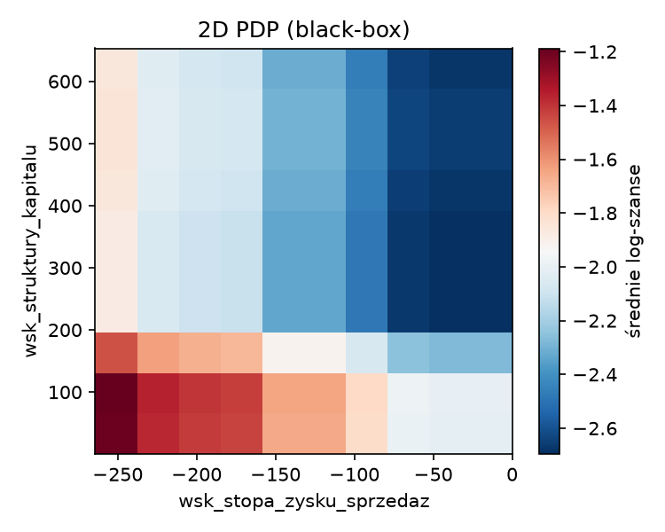

- **Ważność permutacyjna**: te same dwie najważniejsze cechy co SHAP (stopa zysku ze sprzedaży, struktura kapitału); zgodność rankingów Spearman 0,60 – permutacja mierzy spadek AUC, a SHAP wkład w prognozę.

**Lokalnie** – 4 case studies z valid. Dla każdej firmy wykres waterfall obu modeli – droga od wartości
bazowej (średnie log-szanse) do prognozy firmy: `05_waterfall_logit_{1-4}.png` (karta, dekompozycja dokładna) i `05_waterfall_bb_{1-4}.png` (LightGBM, TreeSHAP); numeracja = przypadki A–D. Zestawienie: `05_case_studies_shap.png`, kody przyczyn: `05_kody_przyczyn.csv`.

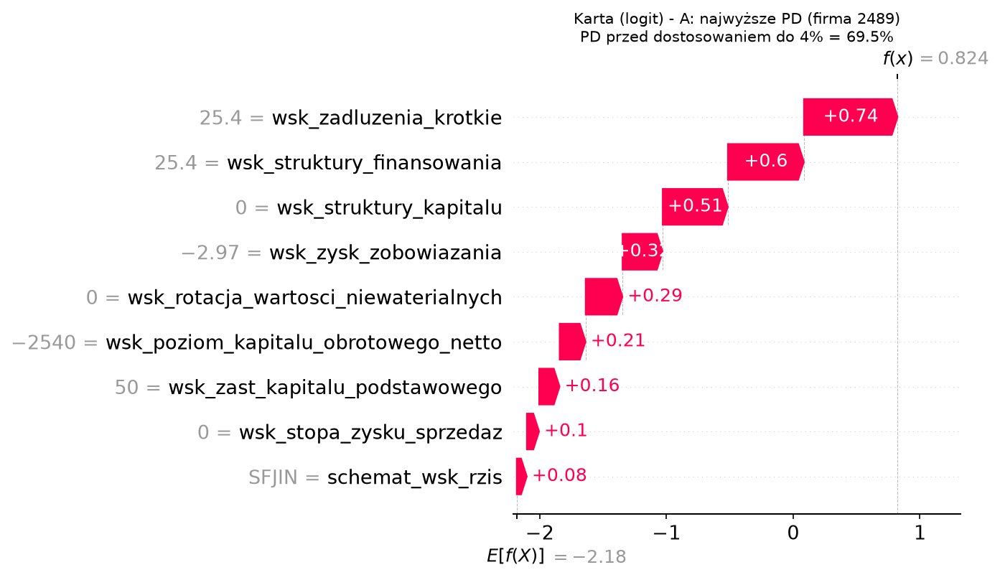 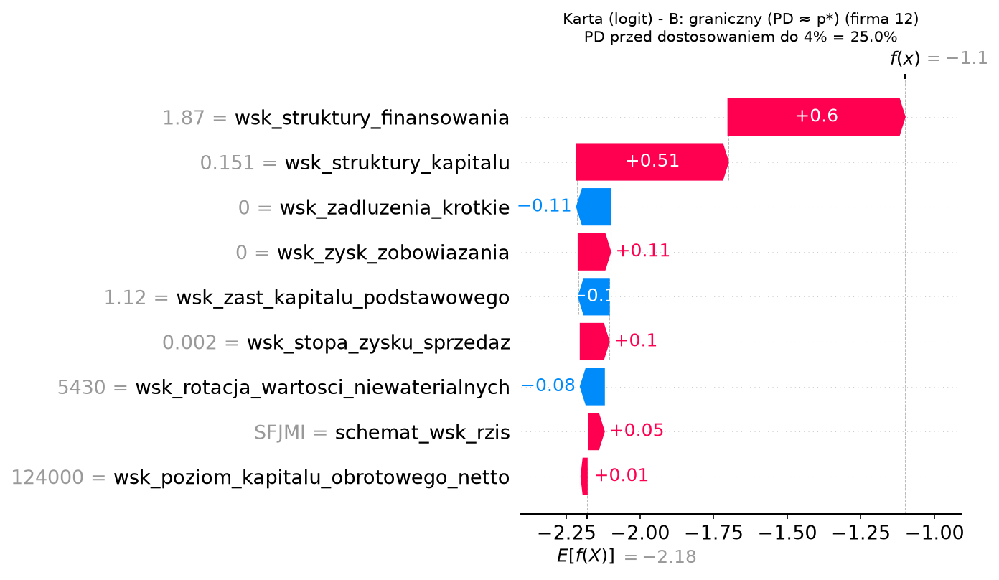
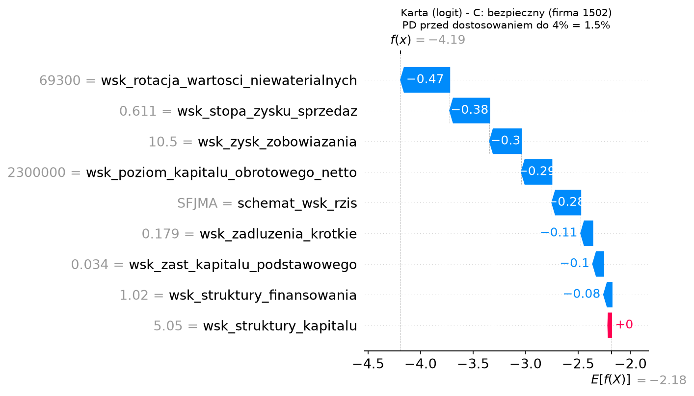 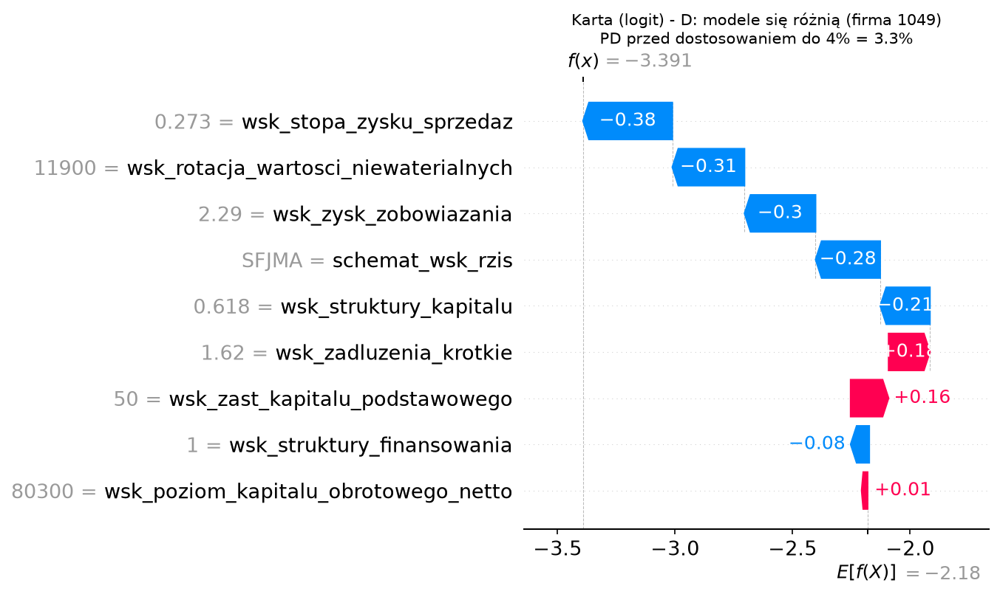

*Rys. Dekompozycja logitu karty dla firm A–D (od lewej u góry: najwyższe PD, graniczna, bezpieczna, modele się różnią).*

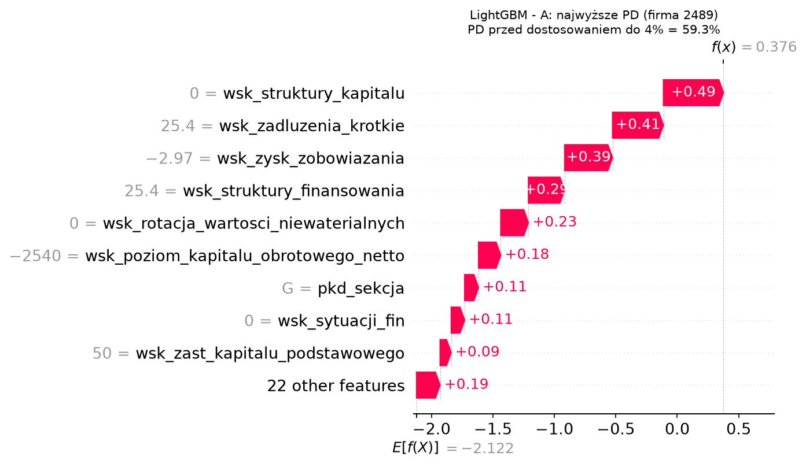 
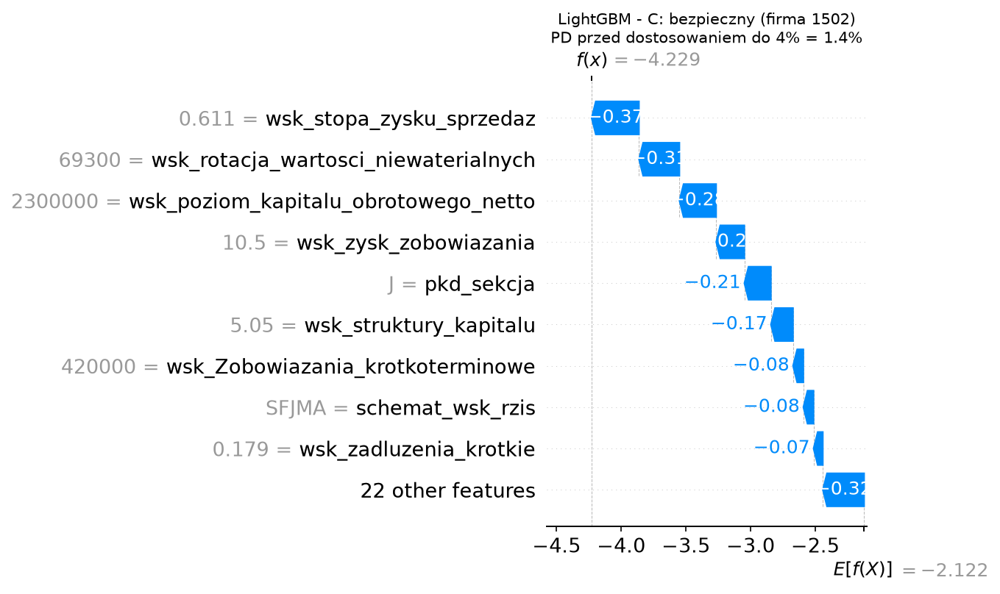 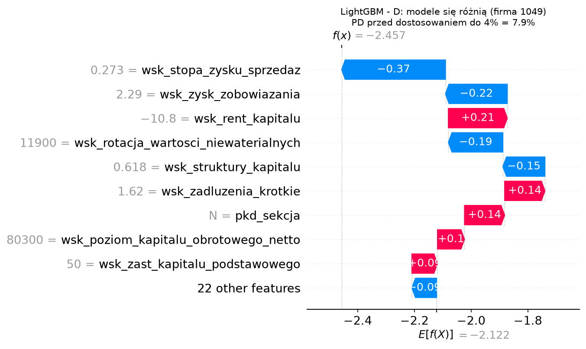

*Rys. Dekompozycja black-box dla firm A–D (od lewej u góry: najwyższe PD, graniczna, bezpieczna, modele się różnią).*

| Przypadek                       | PD karta / LightGBM | Główne przyczyny (oba modele)                                                                                       | Wniosek operacyjny                                           |
| ------------------------------- | ------------------- | ------------------------------------------------------------------------------------------------------------------- | ------------------------------------------------------------ |
| A – najwyższe PD (id 2489)      | 69,5% / 59,3%       | zerowa struktura kapitału, bardzo wysokie zadłużenie krótkoterminowe (25,4), strata względem zobowiązań             | odrzucenie; zgodne w obu modelach                            |
| B – graniczny (id 12)           | 25,0% / 18,3%       | niska struktura kapitału (+0,51 / +0,53), wysoka struktura finansowania (+0,60 / +0,29), zerowy zysk / zobowiązania | decyzja wrażliwa na próg i model; potrzebna ocena ekspercka  |
| C – bezpieczny (id 1502)        | 1,5% / 1,4%         | wszystkie cechy obniżają ryzyko                                                                                     | przyjęcie                                                    |
| D – modele się różnią (id 1049) | 3,3% / 7,9%         | LightGBM: ujemna rentowność kapitału (+0,21) i sekcja PKD N – cechy spoza karty                                     | różnica wynika z innego zestawu cech                         |

**What-if**: dla firmy granicznej krzywe ICE pokazują, że poprawa każdej z trzech głównych przyczyn przesuwa PD poniżej progu.

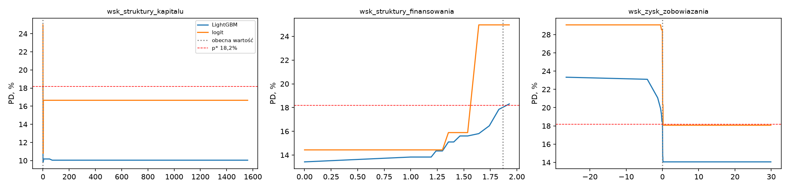

## 6. Wierność i stabilność wyjaśnień – notebook 05

- **Wierność LIME** 

| Statystyka | Lokalne R² | \|błąd aproksymacji PD\| [pp] |
|---|---:|---:|
| średnia | 0,337 | 5,3 |
| odch. std | 0,137 | 4,0 |
| minimum | 0,134 | 0,1 |
| 10. percentyl | 0,175 | 1,5 |
| 25. percentyl | 0,250 | 2,2 |
| **mediana** | **0,308** | **5,1** |
| 75. percentyl | 0,375 | 7,0 |
| 90. percentyl | 0,572 | 9,7 |
| maksimum | 0,658 | 17,8 |

*Tab. 3. Wierność LIME dla LightGBM: 40 losowych firm z valid, 5000 próbek na firmę.*

Lokalne R² mediana 0,31 (10.–90. percentyl: 0,18–0,57), błąd aproksymacji PD mediana 5 pp, maksymalnie 18 pp. W case studies: dla firmy granicznej surogat podaje PD 26% zamiast 18% (po drugiej stronie progu p* = 18,2%), dla firmy bezpiecznej PD ujemne (−7,7%). Zgodność top-5 LIME z SHAP: od 0,43 (przypadek D) do 1,00 (A). Wyjaśnienia LIME mogą więc być mylące przy decyzjach blisko progu.

- **Karta**: wierność pełna – wyjaśnieniem jest sam model. **SHAP LightGBM**: lokalnie dokładny (φ₀ + Σφ = prognoza, błąd 0), ale opisuje model, a nie przyczynowość.
- **Stabilność**:

| Eksperyment | Jaccard top-5 | Spearman |
|---|---|---|
| LIME, 20 seedów, 1000 próbek (firma graniczna) | 0,83 | 0,92 |
| LIME, 20 seedów, 5000 próbek (firma graniczna) | 1,00 | 0,97 |
| SHAP LightGBM, modele z 5 foldów | 0,60 | 0,84 |
| SHAP karta, modele z 5 foldów | 0,77 | 0,64 |

- Karta ma stabilniejszy skład top-5 (Jaccard 0,77 vs 0,60), a niższy Spearman wynika z tego, że 9 cech ma zbliżone ważności, więc drobne zmiany zamieniają kolejność.
- **Ograniczenia SHAP/LIME**: przy korelacji cech wkład dzieli się między nie (SHAP), a w otoczeniu powstają nierealne firmy (LIME, PDP); LIME nie obsługuje braków; wyjaśnienia nie są dowodem zależności przyczynowej.

## 7. Kalibracja i dostosowanie do 4% – notebook 06
**A. Kalibracja statystyczna**
- **Przed kalibracją (valid): średnie PD 14,3% przy DR 13,75%; intercept −0,05, slope 0,93 (karta) / 1,11 (LightGBM); ECE 0,02–0,04 – oba modele dobrze skalibrowane względem próby.

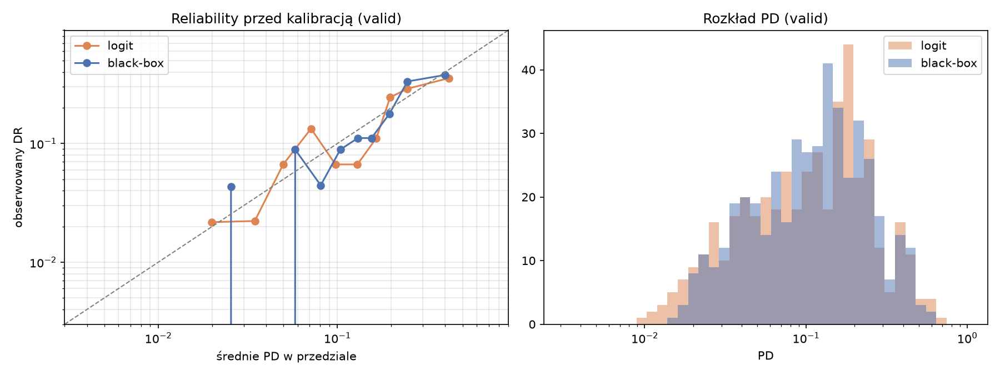

- **Wybór metody** (log-loss w 5-fold CV wewnątrz valid): izotoniczna przeucza się na 451 firmach (0,403 vs 0,355 dla karty), Platt ≈ brak kalibracji → Platt dla obu modeli (karta: a = 0,94, b = −0,15).
- **Po kalibracji kształtu (test)**: karta – Brier 0,110, log-loss 0,366, intercept 0,11, slope 0,88.

**B. Dostosowanie do 4%**
- **Poziom**: δ = −1,44 (karta) / −1,46 (LightGBM) w log-szansach, wyznaczone na valid tak, by średnie PD = 4,00%.
- **Test**:

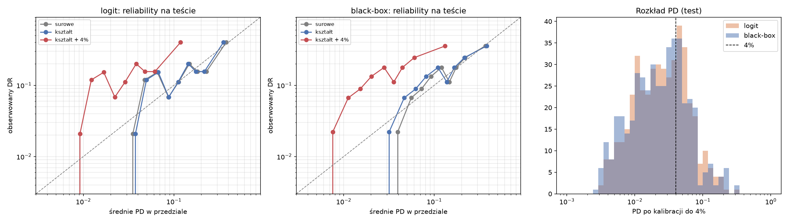

| Karta, test (DR 13,8%) | średnie PD | AUC | Brier | log-loss | ECE | intercept | slope |
|---|---|---|---|---|---|---|---|
| surowe | 13,0% | 0,708 | 0,110 | 0,367 | 0,026 | 0,07 | 0,83 |
| po Platcie | 12,6% | 0,708 | 0,110 | 0,366 | 0,025 | 0,11 | 0,88 |
| po Platcie + 4% | 3,6% | 0,708 | 0,124 | 0,459 | 0,103 | 1,55 | 0,88 |

- **Krzywe reliability**: przed dostosowaniem punkty leżą blisko przekątnej; po przesunięciu krzywa leży **powyżej** przekątnej (w każdym przedziale DR > PD), przesunięta o mniej więcej stały czynnik ok. 3,4. Kształt jest zachowany.

## 8. Progi decyzji, ratingi i analiza kontrfaktyczna – notebook 07
- **Skala**: AAA < 1%, AA 1–2%, A 2–5%, BBB 5–8%, BB 8–12%, B 12–20%, CCC ≥ 20%, D – stwierdzony default.
- **Rozkład**: karta – AAA 18%, AA 24%, A 36%, BBB 15%, BB 4%, B 3%, CCC 1%.

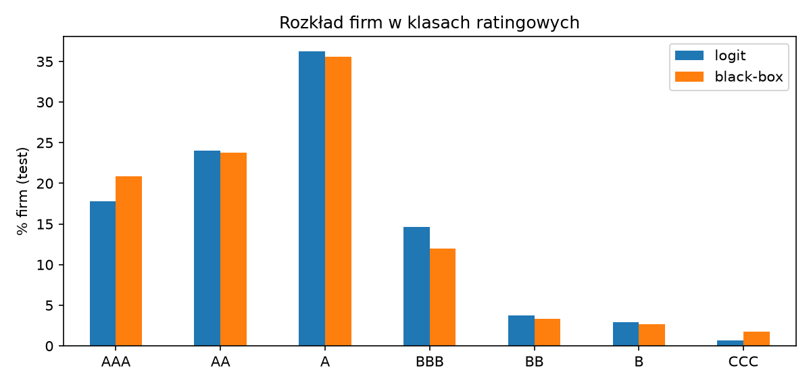

- **Backtest**: w karcie DR rośnie monotonicznie od 1% (AAA) do 67% (CCC); w LightGBM monotoniczność łamie mała klasa BB (15 firm, DR 7%). Światła Jeffreysa dla karty: 3 czerwone, 2 żółte, 2 zielone – w klasach AA–BBB DR jest 4–8 razy wyższy od PD.  Klasy skrajne (CCC: 3 firmy w karcie) są zbyt małe dla wniosków.
- **Funkcja zysku**: przyjęty dobry +MARGIN·EAD, przyjęty zły −LGD·EAD, odrzucony 0; MARGIN 10%, LGD 45%, EAD = 1 → p* = 18,2%. Próg operacyjny wybrany na valid z krzywej zysku.

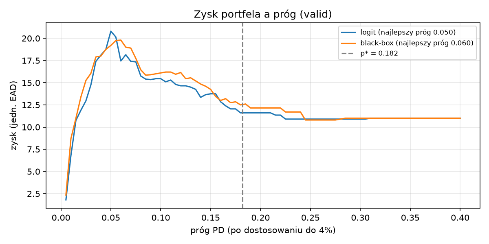

| Próg (test) | Model | Akceptacja | DR przyjętych | EL przyjętych | Strata zrealizowana | Zysk |
|---|---|---|---|---|---|---|
| p* = 18,2% | karta | 99% | 13,0% | 6,8 | 26,1 | 12,6 |
| **próg z valid = 5%** | **karta** | **78%** | **10,0%** | **3,4** | **15,8** | **15,9** |
| próg z valid = 6% | LightGBM | 85% | 9,7% | 3,9 | 16,7 | 17,8 |
| przyjmij wszystkich | – | 100% | 13,8% | 7,3 | 27,9 | 10,9 |

  Próg teoretyczny zastosowany do PD zaniżonego do 4% prawie nikogo nie odrzuca. Próg empiryczny 5% podnosi zysk karty o ok. 45%. Oczekiwana strata jest 4–5 razy niższa od zrealizowanej – ten sam efekt poziomu PD.
- **Porównanie decyzji** (próg z valid każdego modelu): modele zgadzają się w 90% decyzji; ta sama klasa w 67%, różnica ≤ 1 klasa w 99%. Spośród 44 firm z różną decyzją 7 przyjmuje tylko karta (DR 14%), a 37 tylko LightGBM (DR 8%). LightGBM ma wyższy zysk na teście (17,8 vs 15,9) głównie dzięki wyższemu progowi i większej akceptacji.
- **Analiza kontrfaktyczna** (model rekomendowany – karta; firma 273 z valid, PD 10,2%, klasa BB → cel BBB, PD < 8%): zmieniane tylko cechy karty zależne od firmy (8 cech liczbowych; bez schematu sprawozdania i cech, których firma nie raportuje), w granicach 5–95 percentyla danych, z kosztem mierzonym przesunięciem percentylowym. Powiązania między cechami (wariant spójny, |ρ| ≥ 0,6) liczone na wszystkich wskaźnikach, także spoza karty.
  - jedna cecha: wskaźnik struktury kapitału 0,47 → 0,66 (z 27. do 32. percentyla) → PD 7,4%; alternatywa: zadłużenie krótkoterminowe niższe o 10 percentyli → PD 8,0% (tuż przy granicy klasy);
  - karta jest funkcją schodkową: najtańszy kontrfakt to przekroczenie najbliższej granicy przedziału WoE (dla struktury kapitału 0,59), dlatego mała zmiana daje skok PD;
  - wariant spójny: ta sama zmiana pociąga 17 powiązanych wskaźników, które są różnymi wersjami tej samej informacji (udział kapitału własnego, zadłużenie ogólne, mnożnik kapitału) – w praktyce opisuje to dokapitalizowanie albo spłatę części zobowiązań, a PD karty zmienia się tak samo (7,4%), bo karta zawiera tylko jedną cechę z tej grupy;
  - porównanie z SHAP/LIME: główne przyczyny według dekompozycji logitu to zysk / zobowiązania (+0,29), rotacja wartości niematerialnych (+0,29) i rentowność sprzedaży (+0,27), a najtańsze kontrfakty dotyczą struktury kapitału (ranga 7) i zadłużenia krótkoterminowego (ranga 5). To nie jest sprzeczność: SHAP mówi, co obecnie najbardziej podnosi ryzyko, a kontrfakt – co najłatwiej zmienić, bo firma leży blisko granicy przedziału. LIME daje strukturze kapitału wagę ujemną (−0,05) przy dodatnim wkładzie SHAP (+0,16) – lokalne przybliżenie liniowe nie oddaje kształtu U, co jest kolejnym przykładem ograniczonej wierności LIME;

## 9. Audyt podgrup – notebook 08
Małe liczności, więc wnioski są orientacyjne: najsłabsze rozróżnianie mikroprzedsiębiorstw (AUC 0,61 karta / 0,64 LightGBM; uproszczone sprawozdania), najlepsze dla pozostałych jednostek (0,78 / 0,79) i budownictwa (0,79 / 0,81). Kalibracja w podgrupach jest niejednorodna: średnie PD jest podobne we wszystkich grupach (2,6–4,4%), a DR waha się od 6% (przetwórstwo) do 18% (budownictwo). Dane dotyczą firm, nie osób fizycznych, więc brak zmiennych wrażliwych. 

## 10. Porównanie modeli – notebook 08
| Kryterium | **Karta (logit na WoE)** | LightGBM monotoniczny |
|---|---|---|
| Gini test [95% CI] | 0,42 [0,30; 0,55] | 0,46 [0,34; 0,59] |
| ΔGini test (LightGBM − karta) | – | +0,042 [−0,010; +0,091] |
| AUC CV ± sd | 0,718 ± 0,034 | 0,708 ± 0,040 |
| KS / PR-AUC test | 0,34 / 0,31 | 0,35 / 0,30 |
| Złożoność | 9 cech, 38 przedziałów, 10 parametrów | 29 cech, 482 drzewa, 964 liście |
| Interpretowalność | z konstrukcji (punkty karty) | post hoc (SHAP, PDP, LIME) |
| Wierność wyjaśnień | pełna | SHAP dokładny; LIME R² ≈ 0,31 |
| Stabilność wyjaśnień (Jaccard top-5, foldy) | 0,77 | 0,60 |
| Kalibracja surowa (test) | Brier 0,110, slope 0,83 | Brier 0,109, slope 0,99 |
| Kalibracja po 4% (test) | Brier 0,124, intercept 1,55 | Brier 0,123, intercept 1,59 |
| Wynik biznesowy (test, próg z valid) | zysk 15,9 | zysk 17,8 |

## 11. Wnioski
**Czy poprawa jakości black-boxa uzasadnia utratę bezpośredniej interpretowalności?** 
W tym przypadku nie.

LightGBM jest lepszy na valid i teście (o ok. 0,01–0,02 AUC), ale ΔGini na teście ma przedział ufności obejmujący zero, a na walidacji krzyżowej lepsza jest karta. Przy 62 defaultach w zbiorze testowym przewaga nie jest potwierdzona. 

Rekomendacja: karta scoringowa, ponieważ:
- ma statystycznie taką samą skuteczność przy 9 cechach i 10 parametrach zamiast 29 cech i 482 drzew;
- jest interpretowalna z konstrukcji: każda decyzja wynika z punktów za przedziały cech, bez wyjaśnień post hoc i ich problemów z wiernością (LIME R² ≈ 0,31);
- ma stabilniejsze wyjaśnienia (Jaccard 0,77 vs 0,60), monotoniczny DR w klasach ratingowych i kierunki wpływu zgodne z intuicją ekonomiczną;
- oba modele wskazują te same główne czynniki ryzyka, więc karta nie traci istotnej informacji.

---

## Wykorzystanie AI

Przygotowanie szkieletu repozytorium i podziału projektu na części (notebooki), redagowanie kodu i pomoc w naprawie błędów. Wyjaśnienia zagadnień ekonomicznych. Zredagowanie tekstu raportu i przygotowanie struktury MODEL_CARD. Sprawdzenie projektu pod kątem kompletności i zgodności z wymaganiami. Przygotowanie instrukcji uruchomienia README. Wygenerowanie prezentacji.

